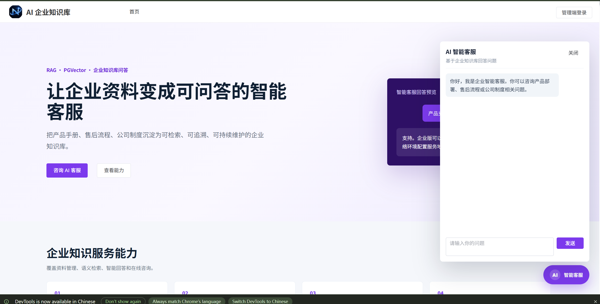
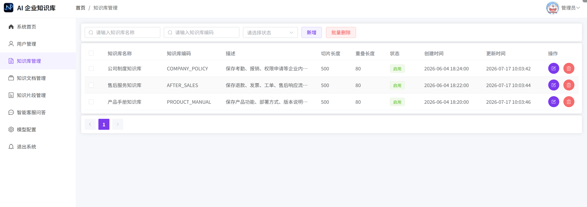
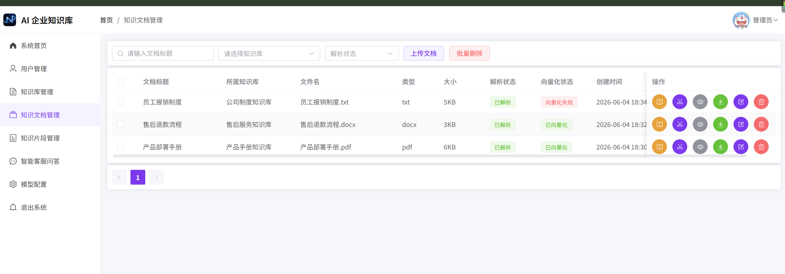
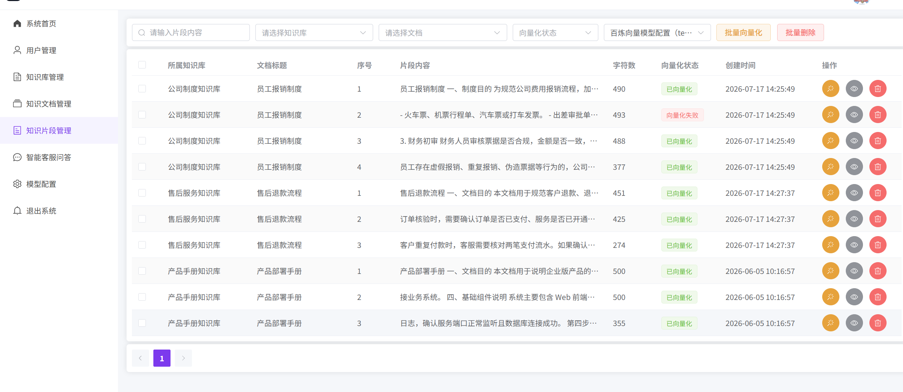
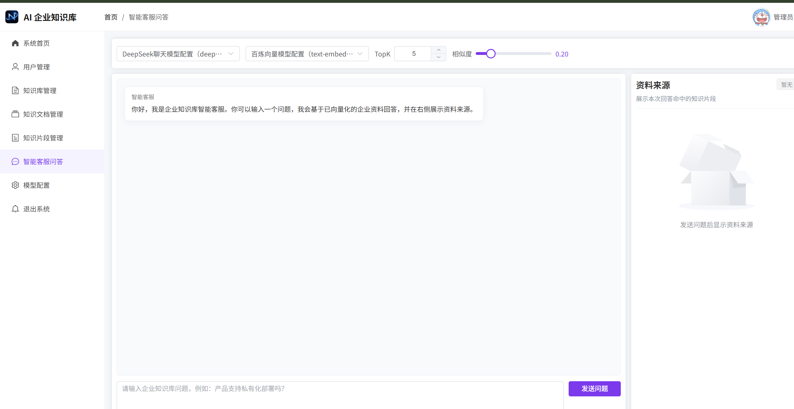
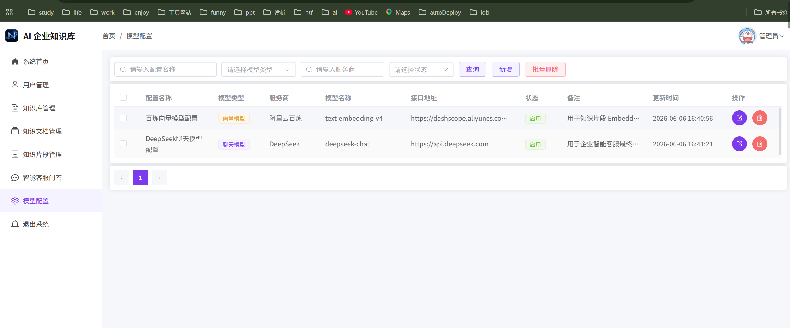

# AI 企业知识库

一个面向企业资料管理与智能客服场景的多智能体知识库系统。Java 负责鉴权、业务数据、文件和 PGVector，Python 直接调用模型并用 LangGraph 编排多个 Agent；前端通过 Java 网关接收经过审查的 SSE 回答与统一证据。

## 核心功能

- **多智能体客服**：按问题并行调度知识库、演示业务和真实 Web 搜索 Agent，并经过 Answer/Reviewer 闭环后流式回答。
- **知识库管理**：维护不同业务知识库及其切片长度、重叠长度和启用状态。
- **文档管理**：支持上传 TXT、DOCX、PDF 等资料，完成文本解析与知识片段生成。
- **知识片段与向量化**：查看文档切片，并使用指定 Embedding 模型进行单条或批量向量化。
- **RAG 问答与溯源**：支持设置 TopK 和相似度阈值，展示回答命中的资料来源。
- **Python 模型 Profiles**：模型调用、凭据和推理由 Python 管理；Java 不保存模型 API Key。
- **系统管理**：包含用户管理、角色区分、个人资料和密码维护等基础功能。

## 功能展示

### 1. 用户端智能客服

用户可以在首页打开智能客服，围绕产品手册、售后流程或公司制度等企业资料进行提问。



### 2. 知识库管理

管理员可以创建多个业务知识库，分别维护知识库编码、描述、切片参数和启用状态。



### 3. 知识文档管理

文档上传后可以执行解析、生成知识片段、查看解析文本和下载等操作，并跟踪解析与向量化状态。



### 4. 知识片段管理

系统按照知识库配置将文档切分为知识片段，支持查看片段内容、选择向量模型以及批量向量化。



### 5. 智能问答与资料溯源

管理端可以选择聊天模型和向量模型，调整 TopK、相似度阈值，并查看回答引用的知识片段。



### 6. AI 模型配置

支持分别配置聊天模型与向量模型，包括服务商、模型名称、接口地址、密钥和启用状态。



## 技术栈

### 前端

- Vue 3
- Vite 5
- Element Plus
- Vue Router
- Axios
- Sass

### 后端

- Java 21
- Spring Boot 3.5
- Spring AI 1.1
- MyBatis + PageHelper
- JWT
- Apache POI（Word 文档解析）
- Apache PDFBox（PDF 文档解析）
- Python 3.12、FastAPI、LangGraph、Pydantic、HTTPX

### 数据与 AI

- PostgreSQL
- pgvector
- OpenAI API 兼容的聊天模型与 Embedding 模型
- SSE 流式问答

## 工作流程

1. 创建知识库并配置文档切片参数。
2. 上传企业文档，解析文本并生成知识片段。
3. 选择 Embedding 模型，将知识片段写入向量库。
4. Java 校验用户后，将签名请求流式代理给 Python；Router 只选择当前用户获准使用的 Agent。
5. Knowledge/Business/Web Agent 并行收集统一证据，Answer 生成草稿，Reviewer 最多触发一次改写或转人工。
6. 审查结束后，Java 将 Python SSE 原样桥接给前端；Python 不可用时按开关回退旧 RAG。

## 项目结构

```text
.
├── ai_knowledge/
│   ├── aiAgent-front/        # Vue 前端
│   ├── aiAgent-back/         # Spring Boot 数据与网关服务
│   └── aiAgent-python/       # FastAPI + LangGraph 多智能体服务
├── files/system/             # README 功能截图
├── ai_knowledge.sql          # 业务表初始化脚本
└── ai_knowledge_vector.sql   # pgvector 初始化脚本
```

## 快速启动

### 1. 初始化数据库

准备 PostgreSQL 数据库并启用 pgvector，依次执行：

```text
ai_knowledge.sql
ai_knowledge_vector.sql
```

然后在 `ai_knowledge/aiAgent-back/src/main/resources/application.yml` 中配置数据库连接。请勿将真实数据库密码或模型密钥提交到公共仓库。

### 2. 启动后端

```bash
cd ai_knowledge/aiAgent-back
mvn spring-boot:run
```

后端默认端口为 `9090`。

### 3. 启动 Python 多智能体服务

参照 `ai_knowledge/aiAgent-python/.env.example` 创建 `.env`，确保 `AGENT_SHARED_SECRET` 与 Java 的 `agent.python.shared-secret` 一致，然后：

```bash
cd ai_knowledge/aiAgent-python
python -m pip install -e ".[test]"
python -m uvicorn app.main:app --host 127.0.0.1 --port 8000
```

Java 可通过环境变量 `AGENT_PYTHON_ENABLED=true` 和 `AGENT_PYTHON_BASE_URL=http://127.0.0.1:8000` 启用新链路。Python 的详细配置与测试方式见该模块 README。

### 4. 启动前端

```bash
cd ai_knowledge/aiAgent-front
npm install
npm run dev
```

前端接口地址由 `.env.development` 或 `.env.production` 中的 `VITE_BASE_URL` 配置。

## 使用提示

- 向量模型输出维度需要与 pgvector 表中的向量维度保持一致。
- 使用智能问答前，需要在 Python `profiles.yaml` 中声明聊天/向量 Profile，并通过环境变量提供对应凭据。
- 企业资料应先完成解析、切片和向量化，才能参与知识检索。
